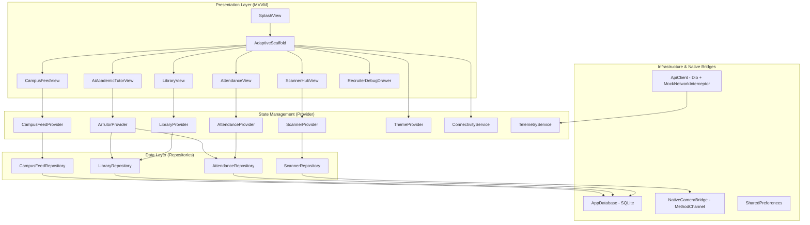
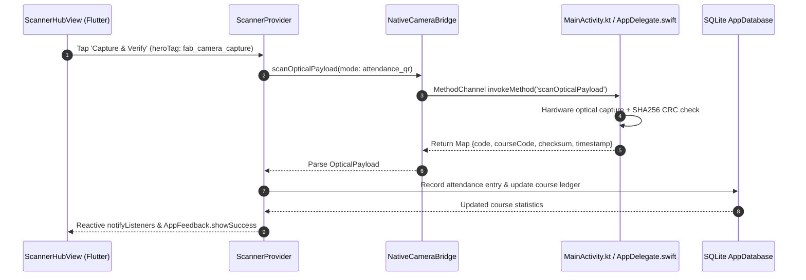

# Cityzens

[](https://github.com/Safeer-Hussain/cityzens/actions/workflows/ci.yml)
[](https://flutter.dev)
[](https://dart.dev)
[](https://developer.android.com)
[](docs/PRD.md)
[](LICENSE)

Production-grade Smart Campus, Digital Library Records, Automated Attendance Tracking, Native Camera Scanner, and AI Academic Ecosystem in Flutter.

---

## Architecture Blueprint

Cityzens follows Feature-First Clean Architecture paired with reactive Model-View-ViewModel (MVVM) state management via Provider, Dependency Injection via GetIt, and local relational persistence via SQLite.



---

## Native Optical Camera Bridge Sequence



---

## Feature Matrix

| Module | Core Capabilities | Persistence / Hardware Driver | Viewport Safety |
| :--- | :--- | :--- | :--- |
| **Attendance Tracker** | Student/Faculty role switch, 6-week trendline chart, at-risk calculator, manual PIN & leave modals | SQLite `courses` and `attendance_ledger` tables | Two-pane master-detail landscape, wrap-safe chips |
| **Digital Library** | 42 seeded CS books, debounced search, category chips, 1-tap renew loan (+14 days), fine computation | SQLite `library_books` and `library_loans` tables | Explicit `mainAxisExtent: 145` preventing RenderFlex collapse |
| **Optical Scanner Hub** | Viewfinder targeting reticles, animated laser line, torch toggle, QR / ISBN / Smart ID modes | `com.safeer.cityzens/native_camera` | Landscape split pane with live hardware telemetry |
| **AI Academic Tutor** | Queries live SQLite attendance & loans, word-by-word streaming animation, 4 research prompt chips | On-device contextual synthesis with guaranteed `try ... finally` cleanup | `resizeToAvoidBottomInset: true` flush keyboard docking |
| **Campus Feed & ID** | Digital ID card (CGPA 3.94 / 4.00), reactive post likes, SQLite comments, publish notices, recruiter hub | SQLite `campus_posts` and `campus_comments` tables | Longitudinal timeline cards and recruiter debug drawer |

---

## Engineering Guidelines & Physical Device Safeguards

1. **Android SDK 36 Compatibility**: `compileSdk = 36` and `targetSdk = 36` with `minSdk = 21` configured in `android/app/build.gradle.kts`.
2. **Impeller Vulkan Crash Protection**: MediaTek and Mali GPU rendering crashes are prevented by explicitly configuring `io.flutter.embedding.android.EnableImpeller = false` in `AndroidManifest.xml`.
3. **Physical Device Boot Hygiene**: `main.dart` initializations run inside `runZonedGuarded` with error interception; all heavy SQLite seeding and image precaching are deferred into `WidgetsBinding.instance.addPostFrameCallback` inside `SplashView`.
4. **Zero Hardcoded Colors**: Colors resolve dynamically through `Theme.of(context).colorScheme`, ensuring complete dark and light mode parity.
5. **Clean Code Hygiene**: Zero tutorial comments, zero placeholders, zero emojis across all code and logs.

---

## Getting Started

### Prerequisites
- Flutter SDK 3.47.8 or higher
- Android SDK 36.0.0
- Java Development Kit (JDK) 17

### Installation & Execution
```bash
# Clone the repository
git clone https://github.com/Safeer-Hussain/cityzens.git
cd cityzens

# Install dependencies
flutter pub get

# Run static analysis
flutter analyze

# Execute automated unit and widget test suite
flutter test --coverage

# Launch application
flutter run
```

---

## Autonomous Sprint Engine

Cityzens includes an autonomous backlog engine in `docs/AUTONOMOUS_BACKLOG.md` comprising 25 daily engineering sprints. To execute the next sprint autonomously:

```bash
# Within an Antigravity agentic session:
"run daily sprint"
```

The system will locate the next unchecked backlog item, engineer the full feature set across layers with SQLite persistence and unit tests, verify static analysis and tests, mark the item as complete, and push to `origin main`.

---

## Clean-Room NDA Disclaimer

This software represents an original, clean-room software architecture developed independently by Safeer Hussain. All database schemas, software algorithms, native optical camera bridges, and UI components were created from first principles without incorporation of proprietary third-party trade secrets or non-disclosure agreements.
